<!-- ═══════════════════════════════════════════════════════════════
     BEFORE PUBLISHING: replace BOTH occurrences of
     YOUR_EMAIL@example.com with your real contact email.
     Keep the /assets folder next to this file (same repo).
     ═══════════════════════════════════════════════════════════════ -->

  

 

 

## `01 / about me`

I'm an engineering student focused on **AI/ML, computer vision, and applied research**. I enjoy moving from an idea to an actual working system: experimenting with models, writing code, and understanding *why* things work.

<table>
<tr>
<td width="50%" valign="top">

**🔬 Previously**
 Computer Vision Research Intern at BEL CRL (Bharat Electronics Limited, Central Research Laboratory)

**🧭 Research work**
 Real-time traversable path detection for autonomous navigation

</td>
<td width="50%" valign="top">

**🧠 Interests**
 Computer vision · Deep learning · LLMs · RAG · Agentic AI · Time-series forecasting

**⚡ Approach**
 Prototype → test → improve → repeat

</td>
</tr>
</table>

 

## `02 / research experience`

<table>
<tr>
<td width="100%">

### 🛰️ Computer Vision Research Intern · BEL CRL
<code>RESEARCH &amp; DEVELOPMENT</code> &nbsp;·&nbsp; <code>AUTONOMOUS NAVIGATION</code>

 

Worked on **real-time traversable path detection** for autonomous navigation, exploring vision-based methods to identify navigable free space in visual scenes.

**Project:** *Real-time Traversable Path Detection for Autonomous Navigation*

 

</td>
</tr>
</table>

 

## `03 / selected work`

<table>
<tr>
<td width="50%" valign="top">

### [Traversable Path Detection ↗](https://github.com/Rashi-Rajput?tab=repositories&q=traversable)
Vision-based free-space detection for autonomous navigation, developed during my BEL CRL internship.

</td>
<td width="50%" valign="top">

### [Road Safety RAG Tool ↗](https://github.com/Rashi-Rajput?tab=repositories&q=road)
An application exploring retrieval-augmented generation for road safety information.

</td>
</tr>
<tr>
<td width="50%" valign="top">

### [BehindTheSceneAI ↗](https://github.com/Rashi-Rajput?tab=repositories&q=behindthescene)
Exploring multi-agent approaches to causal intelligence.

</td>
<td width="50%" valign="top">

### [Time-Series Forecasting ↗](https://github.com/Rashi-Rajput?tab=repositories&q=forecast)
Statistical and machine-learning approaches to forecasting sequential data.

</td>
</tr>
</table>

 

## `04 / tools I work with`

<code>Python</code> · <code>PyTorch</code> · <code>OpenCV</code> · <code>scikit-learn</code> · <code>FastAPI</code> · <code>Django</code> · <code>Git</code> · <code>GitHub</code> · <code>Linux</code> · <code>VS Code</code>

 

## `05 / leetcode`

Live coding statistics · Click the card to visit my LeetCode profile

 

### ✦ &nbsp; Let's make something meaningful. &nbsp; ✦

Have an idea, research question, or collaboration in mind? I'd love to connect.

<a href="https://www.linkedin.com/in/rashi-rajput-a76826395/">LinkedIn</a> &nbsp;·&nbsp; <a href="mailto:YOUR_EMAIL@example.com">Email me</a> &nbsp;·&nbsp; <a href="https://leetcode.com/u/skQzi669XU/">LeetCode</a>

  

